# PrismPrice — Architecture Review & Modernization Plan

**Assessment date:** 31 October 2026
**Purpose:** establish an evidence-based target architecture and delivery plan for improving the pricing models and the system around them. This document distinguishes code that exists from capabilities that are integrated, production-operated, or validated on retailer data.

## Executive direction

Evolve PrismPrice as a **governed pricing decision platform**, starting as a modular monolith with explicit interfaces around data, feature assembly, model bundles, policy, decision records, and serving. Keep model training and online recommendation as separate execution paths. Split services only when measured load, ownership, or reliability needs justify it.

The repository already contains a substantial set of individual components: data contracts, a DuckDB store, point-in-time feature assembly, demand and elasticity estimators, retention and competitor models, optimization, guardrails, learning utilities, observability code, a FastAPI service, and a browser workbench. The main architectural gap is that these components are not yet one production lifecycle. The current HTTP service calls injected prediction functions; its in-memory model store is a test and wiring adapter. The DuckDB data/decision store is a separate component and is not automatically used by the serving path. There is no production artifact registry or source-system connector in this repository.

The next goal should be a single, auditable, recommendation-only vertical slice that joins point-in-time inputs, a versioned model bundle, policy evaluation, and durable decision recording. Validate it on representative retailer data before expanding automation or adding more model complexity.

## 1. Current baseline and evidence

| Area | Present in the repository | Gap before production operation |
|---|---|---|
| Data contracts | Named contracts, quality reports, checks, and a DuckDB ingestion boundary in `data/` and `storage/`. | Ingestion is not connected to retailer source systems; the local analytical store is not a hosted multi-user serving database. |
| Data persistence | `PriceStore` records ingest batches, transactions, daily demand, and immutable decision JSON. | Serving does not persist decisions through `PriceStore`; other business facts such as effective-dated cost, inventory snapshots, promotion exposure, and competitor history are not all represented in its schema. |
| Features | `FeatureBuilder` makes trailing features using rows strictly before `as_of`; uncensoring and embedding-prior utilities exist. | Feature building is not wired into `DecisionService`; an online/offline feature snapshot contract is not yet part of the request lifecycle. |
| Estimation | Demand quantiles, causal elasticity, retention, and competitor estimators are implemented as modules. | Their training, evaluation, release, and serving contracts are not unified by a production model bundle or registry. Repository evaluation is not a substitute for retailer-specific validation. |
| Decision and policy | Candidate scoring, markdown optimization, policy parameters, reason codes, and guardrails are implemented. | The online service does not yet connect every model output or portfolio input to one fully versioned runtime context. Inventory quantity is an optional engine argument and is not supplied by the current service path. |
| Serving | FastAPI factory, authentication hooks, bounded batches, typed requests, and explicit outage degradation exist. | `InMemoryModelStore` is the only model-store implementation shown here. The service does not fetch artifact versions from the store or durably append its records. Rung 5 holds the request's `current_price`, which may differ from the last price actually published. |
| Audit | Frozen `DecisionRecord` schema, seeds, candidate scores, estimates, policy version, and a DuckDB append-only decision table exist. | A decision's model versions are supplied through engine configuration; data/feature snapshot IDs, artifact digests, policy config digest, software environment, and automatic serving persistence are not end-to-end bound together. |
| Learning and monitoring | Experiment, bandit, off-policy evaluation, KPI, drift, alert, and dashboard modules exist. | They need live outcome joins, ownership, alert routing, and release gates before their outputs can govern live pricing. |
| Operations | Packaging, optional dependency groups, web workbench, and local scripts exist. | No hosted deployment, managed secrets, source connectors, production identity integration, operational SLOs, or recovery procedure is delivered by this repository. |

These are different maturity levels. “Implemented” means code is present; it does not imply that a component is integrated, deployed, approved for a market, or accurate on a retailer's data.

## 2. Target architecture

### 2.1 Deployment shape

Use two execution planes over shared contracts and versioned artifacts:

1. **Offline control plane:** ingest and validate data, build point-in-time panels and features, train models, run temporal and causal evaluation, compare challengers, and publish an immutable model bundle only after release gates pass.
2. **Online decision plane:** assemble a point-in-time decision context, load a pinned model bundle and policy, score feasible candidates, persist the complete decision record, and return a recommendation for human review.

Initially these can be Python modules and scheduled jobs in one repository. Keep the model registry, feature repository, decision ledger, and external price publisher behind ports so local DuckDB and in-memory adapters can be replaced without rewriting model logic.

```mermaid
flowchart LR
  subgraph offline[Offline control plane]
    sources[Retailer sources] --> ingest[Ingestion adapters]
    ingest --> contracts[Contracts and quality gates]
    contracts --> history[Versioned canonical history]
    history --> features[Point-in-time feature pipeline]
    features --> train[Train and calibrate estimators]
    train --> eval[Temporal, causal, policy and fairness evaluation]
    eval --> registry[Immutable model bundle registry]
  end

  subgraph online[Online decision plane]
    api[Authenticated API] --> context[Decision context assembler]
    context --> bundle[Pinned model bundle]
    bundle --> forecasts[Demand, elasticity, CLV and inventory estimates]
    forecasts --> objective[Candidate simulation and objective]
    objective --> policy[Hard guardrails and degradation rules]
    policy --> ledger[Append-only decision ledger]
    ledger --> review[Recommendation and human review]
    review -. separate approved integration .-> publisher[Retailer price publisher]
  end

  registry --> bundle
  history --> context
  telemetry[Metrics, traces, drift, realized outcomes] -. observes .-> offline
  telemetry -. observes .-> online
```

No service may publish a price as a side effect of scoring. A future publisher is a separate adapter with its own approval state, idempotency key, reconciliation, and rollback record.

### 2.2 Bounded contexts and ownership

| Context | Owns | Existing code to build on | Required boundary |
|---|---|---|---|
| Data ingestion | Source adapters, batch identity, schema validation, quarantine, deduplication | `data/contracts.py`, `data/sources.py`, `storage/store.py` | `IngestBatch` and a `SourceRepository` port; every accepted batch has a stable ID and quality report. |
| Canonical data and features | Effective-dated facts, event time, point-in-time joins, feature definitions and snapshots | `features/builder.py`, `features/uncensoring.py`, `storage/` | `DecisionContext` assembled from facts known at `as_of`; snapshot ID and feature definition version accompany the vector. |
| Model development | Training, calibration, evaluation, model cards, release decision | `estimation/`, `observability/evaluation.py`, synthetic data | A model artifact has a typed input/output contract, immutable digest, training data reference, evaluation report, and supported range. |
| Pricing decision | Candidate generation, portfolio economics, uncertainty simulation, explanation | `decision/`, `governance/schemas.py` | Pure application service receives context, model bundle, and policy; it does not load files, call HTTP, or publish prices. |
| Policy and governance | Guardrails, jurisdiction policy, approval, overrides, supersession | `governance/`, `provenance.py` | Versioned policy bundle with named owner, approval, effective dates, and an immutable config digest. |
| Serving | Authentication, request limits, idempotency, serialization, health, batching | `serving/` | HTTP translates to application commands; no economics or data access logic lives in route handlers. |
| Decision ledger | Durable append-only request, estimates, candidates, checks, approval and outcome links | `DecisionRecord`, `PriceStore.record_decision()` | `DecisionRepository` port; the serving use case must commit before returning a recommendation. |
| Learning and observability | Live outcome joins, experiments, scorecards, drift, alert ownership | `learning/`, `observability/` | Every metric names its population, window, owner, threshold, and action; alerts link to decision and model versions. |

Keep dependencies inward: adapters call application services; domain and policy code depend on typed contracts, not FastAPI, DuckDB, LightGBM, or cloud vendors. Use constructor injection at one composition root to wire implementations and versions.

## 3. End-to-end decision contract

### 3.1 Request and context assembly

Treat an API request as a command to evaluate a price, not as a container for all model features. The application assembles a `DecisionContext` from:

- Request identity, SKU, currency, market, decision time, current published price, and request idempotency key.
- Effective-dated cost and tax basis; price and promotion history; recent inventory and replenishment; competitor observations with source and observed time.
- Point-in-time demand, exposure, promotion, seasonality, and category-substitute features.
- The exact policy and model bundle selected for the SKU, category, market, and time.

Reject or explicitly degrade when required facts are missing, stale, conflicting, or outside the model's supported range. Never silently turn missing cost, inventory, or customer linkage into a numeric zero. Record whether each input was observed, derived, assumed, or unavailable.

Use both **event time** (when the fact was true) and **ingestion time** (when the system learned it). Training and replay must only use facts available to the system at the historical decision time; corrections arriving later must not rewrite the evidence for an earlier decision.

### 3.2 Versioned model bundle

Release a bundle as an immutable manifest, not a mutable “latest” model pointer. Each bundle should include:

- Demand model and quantile calibration artifact, with supported SKU/category and price ranges.
- Causal elasticity estimate or pooled prior, its uncertainty, identification diagnostics, and fallback reason.
- Retention/CLV model and horizon/discount assumptions, marked unavailable when required customer history is not representative.
- Competitor response model only where reaction is identifiable; otherwise expose competitor price as context and do not claim a game-theoretic response estimate.
- Inventory opportunity-cost method and availability convention.
- Feature schema and transformation version; training data snapshot IDs; code commit; library/runtime versions; random seeds; artifact checksums; evaluation and approval references.

At request start, resolve one bundle ID and use it for every candidate. Do not mix demand from one release with CLV or calibration from another. Store the resolved bundle ID and component digests in the decision record. If the store is unavailable, either use a verified local cached bundle under a defined freshness rule or hold the last confirmed published price and report the exact degradation reason.

### 3.3 Model contracts and improvement sequence

| Model | Runtime output | Professional validation before use |
|---|---|---|
| Demand | Distribution or calibrated quantiles at candidate price and context, plus support/out-of-range signal | Rolling-origin backtests; quantile coverage and pinball loss by category, price band, promotion, and stockout state; compare against simple seasonal and price-aware baselines. |
| Price response | Causal elasticity or response curve with interval, overlap/positivity diagnostics, and confidence tier | Temporal cross-fitting; pre-treatment confounder audit; placebo and sensitivity checks; randomized/switchback evidence where feasible. Block extrapolation when candidate prices lack support. |
| Retention / CLV | Incremental future contribution attributable to the price intervention with horizon and interval | Time-based holdout, censoring and competing-risk checks, calibration by cohort, and explicit guest-customer coverage. Do not equate correlation between high prices and churn with causal price impact. |
| Inventory | Available-to-promise quantity, replenishment timing, and opportunity cost with units and horizon | Reconcile with stock ledger and replenishment plans; evaluate sell-through, stockout, and lost-margin impacts. A shadow price must not be confused with unit cost. |
| Competitor response | Reaction distribution only when repeated, timestamped observations identify reactions | Check price-match coverage, observation staleness, competitor availability, common shocks, and stability. If identification fails, omit the strategic response term and expose the limitation. |
| Portfolio demand | Joint demand or substitution effects across a defined category set | Hold out entire time blocks and category interventions; measure cannibalization, category profit, and stock constraints jointly. Avoid treating independent SKU forecasts as independent when substitutes share demand. |

Keep the economic objective single-sourced. Define contribution profit, currency, tax/cost treatment, inventory consumption, horizon, discounting, and tail-risk convention once. Ensure demand, causal price response, and CLV do not count the same price effect twice. Apply hard governance constraints after scoring every candidate; no learned model may relax a guardrail.

Use uncertainty throughout candidate scoring. Report expected contribution and downside risk with their units, horizon, and alpha. Include model uncertainty and demand noise where supported; do not label a point forecast as a distribution. When uncertainty or extrapolation is excessive, widen constraints or return a pooled/hold recommendation with a reason code.

## 4. Data and lineage contract

### 4.1 Canonical entities to support

Establish typed, effective-dated records for products/SKUs, cost and tax, published price events, promotions and exposure, transaction lines and returns, inventory snapshots and receipts, competitor observations, experiment assignment and propensity, policy releases, model bundles, decisions, approvals, and realized outcomes. Customer-level data should be pseudonymous, minimized, access-controlled, and excluded from the pricing request contract.

Every quantity declares a unit and every monetary value declares a currency and tax basis. Normalize time to UTC while preserving the source timezone where retail trading dates require it. Retain the source batch and row lineage for derived panels.

### 4.2 Quality and replay rules

- Validate schema, keys, ranges, freshness, referential integrity, and domain checks before data becomes available to features.
- Quarantine rejected records with batch ID, report, and reason; never silently drop or coerce a row that changes demand or price.
- Make ingestion idempotent using source identity plus stable record keys; corrections are versioned events, not destructive rewrites.
- Preserve raw source snapshots or immutable references and transformation versions so a training set and a decision context can be replayed.
- Apply point-in-time joins with `known_at <= as_of`; use strict-before semantics for outcomes that occur on the decision date.
- Track stockouts and product availability so “zero sales” is not automatically interpreted as zero demand.
- Keep consent, retention, deletion, and aggregation rules for any customer-linked data explicit before using it for CLV.

DuckDB remains appropriate for local analysis and reproducible demos. For a hosted deployment, choose storage by workload: object storage/columnar files for immutable history and training snapshots, and a transactional database for serving state, policy releases, approvals, idempotency, and the decision ledger. Put both behind repository interfaces; do not present a connection-string change as a complete migration because concurrency, transactions, migrations, backup, access control, and operations differ.

## 5. Decision record and human workflow

Treat a recommendation as an immutable proposal with lifecycle events, rather than a mutable price row:

`PROPOSED → REVIEWED → APPROVED | REJECTED → APPLIED → OUTCOME_OBSERVED`

An override, correction, or replacement creates a new event/decision linked by `supersedes_id`; it never edits the original evidence. The target record should add to the existing schema:

- Schema version, tenant/market, currency, request/idempotency ID, and publication state.
- Full input snapshot or immutable feature snapshot reference, source timestamps, quality state, and assumptions.
- Model bundle ID and per-component artifact digest; policy ID and canonical policy digest; code and runtime versions.
- Estimates with intervals, calibration/support diagnostics, objective decomposition and units, candidate feasibility, and every guardrail outcome.
- Degradation/fallback details, seed, approval identity/time, override reason, applied price event ID, and subsequent measured outcomes.

The service must call a `DecisionRepository` after scoring and before returning success. If audit persistence fails, it must not return a recommendation that looks fully auditable. Return a typed service-unavailable response or a clearly specified safe hold result that is itself durably recorded when possible. Define this contract before implementing retries, because retrying a non-idempotent decision can create duplicate approvals or price changes.

The default product workflow remains recommendation-only. A reviewer sees the recommendation, plausible range, top drivers, binding constraints, data freshness, model confidence/support, and degradation status. Approval, rejection, or override is captured with identity and reason. Publishing remains an explicit downstream command and requires reconciliation against the actual live price.

## 6. Online reliability, security, and operations

### Reliability

- Define separate liveness and readiness. Readiness checks the active policy, required repositories, and a usable model bundle; liveness only indicates the process can answer health checks.
- Set request timeouts and concurrency limits for model scoring; keep bounded batch sizes and per-item outcomes. Add a request idempotency key and per-SKU ordering rules before asynchronous jobs are introduced.
- Define freshness budgets separately for cost, current price, inventory, competitor data, and each model bundle. A single “healthy” boolean is not enough to describe decision readiness.
- Keep typed degradation states for missing/stale inputs, unavailable artifacts, unsupported extrapolation, empty feasible sets, and audit-store failure. Preserve the current price only if it is the confirmed published price and the hold itself is allowed by market policy.
- Record latency and failures by stage; alert on degraded decision rate, stale inputs, failed persistence, model age, and mismatch between recommended and applied prices.
- Set recovery objectives and exercise backup/restore for decision history, model artifacts, policies, and source snapshots before calling the service production-ready.

### Security and privacy

- Keep the current shared API key for trusted local integrations only. Use an identity-aware gateway or OIDC workload/user identity for a multi-user hosted service; scope access by tenant, market, and role.
- Store credentials in a managed secret store, rotate them, terminate TLS at a trusted gateway, and apply rate limits and audit logging.
- Restrict internal diagnostics and document endpoints; avoid returning infrastructure details, customer identifiers, or raw model artifacts to the public workbench.
- Separate operator, reviewer, policy approver, and deployment roles. Require a second authorized approval for policy changes and production bundle promotion where business governance calls for it.
- Retain only the minimum customer data needed for aggregate retention analysis. Keep identity attributes out of decision features and assess outcome parity by lawful, privacy-reviewed groups using a separate evaluation path.

### Observability and product metrics

Track three layers, not just model accuracy:

1. **Data and model health:** contract failures, freshness, feature drift, quantile calibration, elasticity support/interval width, CLV calibration, bundle age, and category-level coverage.
2. **Decision quality and safety:** feasible-candidate rate, fallback/degradation rate, guardrail violations (must remain zero among selected prices), price movement, recommendation-to-approval and override rate, and category-level simulated downside.
3. **Realized business outcomes:** incremental contribution profit, margin, units, stockouts, sell-through, repeat purchase, customer retention, and price execution lag. Use control groups or credible causal evaluation; do not attribute raw before/after changes to the pricing model.

Every metric needs a definition, data source, cohort/window, owner, threshold, and response. Separate offline backtest metrics from shadow, approved, applied, and randomized-experiment outcomes in dashboards.

## 7. Evaluation and release gates

Use a staged evidence ladder for every model or policy change:

1. **Contract and synthetic checks:** known ground truth, edge cases, leakage, invariants, and reproducibility. Synthetic data demonstrates implementation behavior, not market validity.
2. **Historical temporal backtest:** chronological train/validation/test windows, point-in-time replay, baselines, segment metrics, stress periods, and no tuning on the final holdout.
3. **Causal and policy review:** overlap, confounding, sensitivity, calibration, off-policy assumptions, support limits, and portfolio/cannibalization accounting.
4. **Shadow mode:** produce and persist recommendations without affecting published prices; reconcile inputs, score distributions, policy decisions, and latency on live feeds.
5. **Human-approved pilot:** small, explicitly selected scope with holdout/control, local policy approvals, maximum price movement, kill switch, and daily review.
6. **Controlled expansion:** widen only after realized contribution and safety gates pass for the agreed observation horizon. Exploration or bandits require an independently approved risk budget and valid propensities.

Release gates must be defined per market/category before live use. At minimum: point-in-time and lineage completeness; forecast calibration within agreed bounds; no unsupported candidate extrapolation; stable causal estimates or explicit fallback; zero selected-price policy violations; complete durable audit records; known hold behavior on each dependency failure; and no material adverse outcome versus the approved baseline/control.

## 8. Delivery roadmap

| Stage | Deliverable | Exit evidence |
|---|---|---|
| 0. Correct the architecture contract | Align implementation status docs; define `DecisionContext`, `ModelBundle`, `DecisionRepository`, and policy release contracts. Record unresolved business choices below. | A reviewer can trace every documented component to code or a clearly labeled future adapter; each interface has an owner and schema. |
| 1. Connected vertical slice | Wire a real point-in-time feature/context adapter, a pinned bundle adapter, the existing engine/guardrails, and durable decision persistence behind injected ports. Keep recommendation-only. | One request can be replayed from stored input and bundle references; model versions are resolved from the bundle, not hand-copied into engine config; duplicate request behavior is defined. |
| 2. Data and model readiness | Add effective-dated canonical inputs, training snapshots, bundle manifest/release checks, and retailer-specific temporal/causal evaluation reports. | Shadow recommendations pass data, calibration, support, guardrail, and audit gates on agreed categories. |
| 3. Human approval operations | Add review, approve/reject, override, supersede, and applied-price reconciliation events with role-based identity. | Every proposed price has a durable owner and disposition; actual applied price can be joined to its decision. |
| 4. Controlled impact measurement | Join realized sales, stock, margin, and repeat behavior; start a pre-registered switchback/store experiment only when the data and policy allow it. | Incremental outcome estimate and uncertainty are reviewed against control, with safety and stop rules. |
| 5. Scale selectively | Add queues, horizontal workers, hosted storage, cache, or service splits only where measured throughput, isolation, or availability requires them. | Load, recovery, isolation, and operational ownership justify each new infrastructure component. |

Do not start with Kubernetes, a feature-store vendor, a streaming bus, or multiple microservices. First prove the contracts and the end-to-end decision lifecycle; then choose infrastructure against measured service-level and data-volume needs.

## 9. Decisions that require business or deployment inputs

Resolve these before a live pilot; defaults in code are not approvals:

- Target retailer, category, market/jurisdiction, currency, tax and fully-loaded cost definitions.
- Recommendation cadence, price execution lag, allowed operating hours, and confirmed source of current published price.
- Approved margin, movement, competitor, fairness, promotion, inventory, and change-frequency policies with named owners.
- Business horizon and objective tradeoff for immediate contribution, retention/CLV, inventory scarcity, and downside risk.
- Required source feeds, event-time guarantees, freshness budgets, history depth, and data retention obligations.
- Human reviewer and approver roles, override thresholds, escalation path, and who can activate a model/policy release.
- Availability, latency, recovery, audit-retention, and data-residency requirements for hosting.
- Minimum evidence and stopping rules for any experiment or future automatic publication.

Where a choice is unresolved, the system should expose a required configuration or return a documented degraded state; it should not quietly inherit a generic demo value.

## 10. Risks and controls

| Risk | Control |
|---|---|
| Observational prices encode the old pricing policy and confounding | Keep forecast and causal response roles explicit; diagnose overlap; use randomized evidence where feasible. |
| Demand, elasticity, and CLV count the same price effect more than once | Define a single causal/economic decomposition and test it against a transparent baseline. |
| Stockouts are interpreted as low demand | Track availability and censoring; calibrate uncensoring on known synthetic truth and real replenishment data. |
| Stale or revised data leaks into backtests | Preserve event and ingestion time, immutable snapshots, and strict point-in-time joins. |
| A valid per-SKU choice harms category profit or availability | Score a bounded category portfolio with cross-price effects and shared inventory constraints before enabling portfolio policy. |
| Model or data outage silently serves an unreviewed stale price | Explicit per-dependency readiness, confirmed-current-price source, typed degradation, persisted incident and alert. |
| Incomplete audit record prevents reconstruction | Commit the full context, bundle/policy IDs, artifact digests, and record before returning the recommendation. |
| “Fairness guardrail” is mistaken for outcome fairness | Keep request-schema exclusion and outcome fairness evaluation as separate controls; review affected segments. |
| A synthetic benchmark is presented as production evidence | Label every result by evidence stage, dataset, time window, and limitations. |

## 11. Architecture decisions to record as ADRs

| ADR | Decision to capture | Initial recommendation |
|---|---|---|
| ADR-001 | Application topology | Modular monolith plus separate offline jobs until scale or ownership proves otherwise. |
| ADR-002 | Source of truth and storage | DuckDB for local work; production history, operational state, and ledger selected by workload and recovery requirements behind ports. |
| ADR-003 | Model bundle format and promotion | Immutable manifest with component checksums, evaluation report, supported scope, and explicit approval. |
| ADR-004 | Decision persistence semantics | Append-only, idempotent request handling; persist before returning a full recommendation. |
| ADR-005 | Price application | Separate approval and publisher integration; no implicit publishing from scoring. |
| ADR-006 | Identity and tenancy | Trusted local API key for local use; identity-aware gateway and scoped roles for hosted multi-user use. |
| ADR-007 | Objective and evidence | One documented economics contract plus per-market policy approval and causal/temporal release gates. |

## 12. Definition of a production-ready pricing slice

A first category is ready for a controlled, human-approved pilot only when all of these are true:

- Inputs are sourced, time-aware, contracted, fresh enough, and replayable.
- The served bundle is immutable, approved, within its validated scope, and identified in every decision.
- Demand and causal estimates have agreed temporal calibration/support evidence; CLV is used only where its data and causal interpretation are defensible.
- The objective's terms, units, horizon, uncertainty, and policy weights are approved and visible to reviewers.
- Guardrails are hard, market-specific, recorded, and tested at the final recommendation boundary.
- The decision record is durable before a response claims success and can be reconstructed without consulting mutable current tables.
- Outage, stale-data, unsupported-price, empty-feasible-set, and ledger-failure behavior is explicit and observable.
- Review, override, applied-price reconciliation, and outcome measurement have named owners.
- Shadow evidence and a controlled comparison show no unacceptable safety or business regression.

Until those conditions are met, PrismPrice should be presented as a research and decision-support system whose recommendations need local validation and human judgment.
